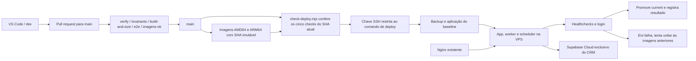

# Deploy do CRM MazyLabs

Destino: **infraestrutura**. O núcleo do CRM e o schema mantêm o comportamento do upstream. Estes arquivos conectam o fork à VPS compartilhada da MazyLabs.

## Fluxo

`dev` também roda o CI. Somente a `main` publica imagens e pode ir para produção. O gate usa os checks do **mesmo SHA da main**, não o resultado de um PR anterior. Eventos superados são ignorados; se algum check falhar, nada é enviado à VPS. A conclusão de cada workflow reavalia o conjunto; uma execução manual também pode reavaliar a main atual.

## Arquivos e acesso

- `.github/workflows/mazylabs-deploy.yml`: gate e conexão SSH.
- `infra/mazylabs/check-deploy.mjs`: identifica main e exige os cinco checks.
- `infra/mazylabs/deploy-entrypoint.sh`: instalado como `/usr/local/sbin/crm-mazylabs-deploy`, root-owned. Aceita apenas `deploy <SHA de 40 caracteres>` e exige que ele seja o topo atual da main.
- `infra/mazylabs/deploy-release.sh`: imagens, backup, baseline, probes e promoção.
- `infra/mazylabs/compose.yml`: usa o Compose original e publica o app somente em `127.0.0.1:3020`. WAHA e Redis continuam privados. O Caddy fica fora desta instalação; o Nginx existente faz HTTPS.
- `infra/mazylabs/nginx.conf`: configuração inicial do domínio. Bloqueia o webhook WAHA global público; webhooks específicos de canais seguem o contrato original.

Na VPS: `/opt/crm-mazylabs/shared/.env` guarda as credenciais, com acesso restrito ao administrador. Cada release recebe um link para esse arquivo; o deploy não substitui segredos. `/opt/crm-mazylabs/releases/<SHA>` contém o código e `.images.env` com os pins daquela release. `/opt/crm-mazylabs/current` aponta para a última release promovida.

No GitHub, environment `production`: `VPS_HOST`, `VPS_PORT`, `VPS_USER`, `VPS_SSH_KEY` e `VPS_KNOWN_HOSTS`. A chave privada é exclusiva desta automação; a chave pública tem comando forçado, sem PTY nem encaminhamento de portas. O usuário de deploy não entra no grupo Docker. O fingerprint do servidor é conferido pela console da Hostinger antes de cadastrar `VPS_KNOWN_HOSTS`. As credenciais do Supabase e do OpenRouter ficam na VPS, fora do GitHub e das imagens.

O deploy usa pacotes públicos do GHCR. A instalação inicial precisa tornar públicos os quatro pacotes pertencentes ao fork antes do primeiro pull. O código MIT mantém os créditos originais.

## Configuração inicial

1. Criar o projeto Supabase separado, aplicar o baseline e preparar a conta administradora. Configurar Site URL e Redirect URLs para o domínio definitivo.
2. Preencher a configuração privada da VPS e os segredos do environment `production`.
3. Instalar o entry point, o usuário e a chave restrita. Verificar Docker Compose >= 2.24.
4. Apontar somente o subdomínio do CRM para a VPS; instalar o virtual host do Nginx, executar `nginx -t` e emitir o certificado com Certbot. Recarregar Nginx somente após validar.
5. Habilitar `ci.yml`, `perf.yml`, `e2e.yml`, `publish-image.yml` e `mazylabs-deploy.yml`. Manter desativadas as automações editoriais e de release do projeto original (`acolhida`, `relogio`, `vigia-de-colisao`, `release`). O agente de atualização do upstream **não** é instalado nesta VPS; esta instalação é atualizada pelo Actions.
6. Proteger a main com os cinco checks obrigatórios e abrir o PR dev → main. Conferir a primeira execução e a tela de login.

Configurar backup diário usando `hostgator-setup-kit/backup.sh` a partir de `current`, `COMPOSE_PROJECT_NAME=crm-mazylabs` e `BACKUP_DIR=/opt/crm-mazylabs/backups`. A retenção do kit é local; configurar cópia externa antes de armazenar dados que não podem ser perdidos. O dump do banco não inclui objetos do Storage cloud: anexos exigem backup separado.

## Falhas e operação

As execuções e o resumo ficam em GitHub → Actions → Deploy CRM MazyLabs. A VPS registra SHA, horário e resultado em `/opt/crm-mazylabs/state/deployments.jsonl`; os logs privados de aplicação do schema ficam em `state/baseline.log`. `flock` impede dois deploys simultâneos. A concorrência do Actions não interrompe uma troca em andamento.

Os serviços e o login precisam responder antes de mudar `current`. Se uma troca falhar, o deploy tenta reiniciar app, worker e scheduler nas imagens da release anterior e termina com erro no Actions. **O schema não é restaurado automaticamente**: ele pode ter recebido novas escritas; restauração de banco é uma operação manual a partir do backup. Uma alteração incompatível de schema exige planejamento de migração antes de integrar na main. No primeiro deploy, ainda não há release anterior para rollback.

## Checklist do sistema vivo

| Item                              | Artefato concreto                                                                     |
| --------------------------------- | ------------------------------------------------------------------------------------- |
| Entrada                           | Push em dev, PR para main e conclusão dos workflows da main                           |
| Saída                             | Imagens no GHCR, release na VPS e CRM servido pelo Nginx                              |
| Registro                          | Actions, deployments.jsonl e logs de schema privados                                  |
| Porta de operação                 | GitHub → Actions → Deploy CRM MazyLabs; workflow_dispatch                             |
| Proteção contra parada silenciosa | Cinco checks, healthchecks, probe do login, erro explícito e rollback de imagens      |
| Retorno da falha                  | Deploy não promove current; Actions falha; operador consulta os logs e corrige na dev |
| Relações                          | dev → CI → GHCR → VPS → Nginx/Supabase; documentadas no diagrama                      |
